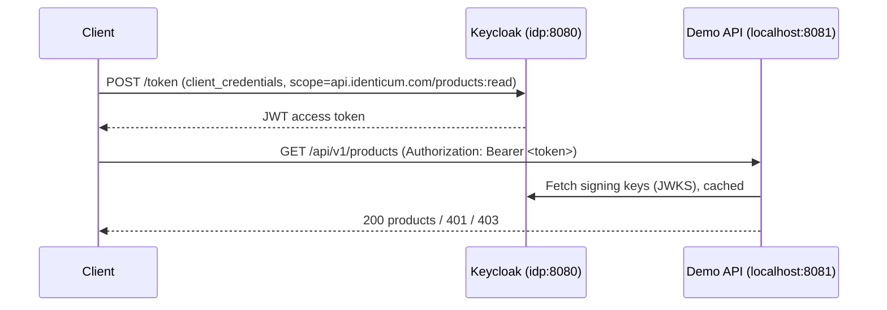

# oauth-demoapi-spring

[](https://github.com/Identicum/oauth-demoapi-spring/actions/workflows/docker-build.yml)

Demo Products API built with Spring Boot, acting as an [OAuth 2.0 Resource Server](https://docs.spring.io/spring-security/reference/servlet/oauth2/resource-server/jwt.html).
It validates JWT access tokens issued by Keycloak and authorizes requests by scope.



| Request | Response |
|---|---|
| No token, or invalid/expired token | `401 Unauthorized` |
| Valid token without the `api.identicum.com/products:read` scope | `403 Forbidden` |
| Valid token with the scope | `200 OK` (`404 Not Found` for an unknown product id) |

## Stack

- Java 25, Spring Boot 4 (Spring Security OAuth2 Resource Server, Spring Data JPA)
- H2 in-memory database, seeded from [import.sql](src/main/resources/import.sql)
- Keycloak 26 with the `demorealm` realm imported from [keycloak/demorealm.json](keycloak/demorealm.json)

## Quickstart

Prerequisite: Docker with Compose.

1. Add `idp` to your hosts file (`/etc/hosts` on Linux/macOS, `C:\Windows\System32\drivers\etc\hosts` on Windows):

   ```
   127.0.0.1 idp
   ```

   The API validates that the token's `iss` claim is `http://idp:8080/realms/demorealm`.
   Keycloak derives the issuer from the hostname used to request the token, so clients on your machine must reach Keycloak as `idp`, the same name the API uses inside Docker.

2. Start Keycloak and the API:

   ```sh
   docker compose up --build
   ```

   The API starts once Keycloak is healthy (about 30 seconds).

3. Get an access token with the products scope and call the API:

   ```sh
   TOKEN=$(curl -s -u testing_client_id:testing_client_secret \
     -d grant_type=client_credentials \
     -d scope=api.identicum.com/products:read \
     http://idp:8080/realms/demorealm/protocol/openid-connect/token | jq -r .access_token)

   curl -H "Authorization: Bearer $TOKEN" http://localhost:8081/api/v1/products
   curl -H "Authorization: Bearer $TOKEN" http://localhost:8081/api/v1/products/1
   ```

   Request a token without `scope=api.identicum.com/products:read` to get `403`, or call the API without the `Authorization` header to get `401`.

### Demo configuration

| Item | Value |
|---|---|
| API | http://localhost:8081/api/v1 |
| Keycloak admin console | http://localhost:8080 (`admin` / `admin`) |
| Realm | `demorealm` |
| Client (client credentials grant) | `testing_client_id` / `testing_client_secret` |
| Scope | `api.identicum.com/products:read` (optional client scope, must be requested) |

These credentials are for local demos only.

The API reads the issuer from the `ISSUER_URI` environment variable (default `http://idp:8080/realms/demorealm`).
Signing keys are discovered from the issuer's OpenID configuration on the first request, so the API starts even if Keycloak is not up yet.

## Postman

Import [oauth-demoapi-spring.postman_collection.json](oauth-demoapi-spring.postman_collection.json) and run the collection in order.
It requests tokens with and without the scope and checks the `401`, `403`, `200` and `404` responses.
It needs the same `idp` hosts entry as the Quickstart.

## Development

Requires Java 25 and Maven.

```sh
mvn test                    # unit tests (no Keycloak needed)
docker compose up -d idp    # Keycloak only
mvn spring-boot:run -Dspring-boot.run.arguments=--server.port=8081
```

The API listens on 8080 by default, which Keycloak already uses, hence `--server.port=8081`.

Pushes to `main` build a multi-arch image (`linux/amd64`, `linux/arm64`) and publish it as `ghcr.io/identicum/oauth-demoapi-spring`; the tests run as part of the image build.

## OpenAPI definition

```yaml
openapi: 3.0.3
info:
  title: Products API
  description: Products API secured with OAuth 2.0 (JWT access tokens)
  version: 1.0.0
  license:
    name: Apache 2.0
    url: https://www.apache.org/licenses/LICENSE-2.0
servers:
  - url: http://localhost:8081/api/v1
tags:
  - name: product
    description: Operations about products
security:
  - oauth2: [api.identicum.com/products:read]
paths:
  /products:
    get:
      tags: [product]
      summary: List products
      operationId: listProducts
      responses:
        '200':
          description: Successful operation
          content:
            application/json:
              schema:
                type: array
                items:
                  $ref: '#/components/schemas/Product'
        '401':
          $ref: '#/components/responses/Unauthorized'
        '403':
          $ref: '#/components/responses/Forbidden'
  /products/{id}:
    get:
      tags: [product]
      summary: Get a product by id
      operationId: getProduct
      parameters:
        - name: id
          in: path
          required: true
          schema:
            type: integer
            format: int64
      responses:
        '200':
          description: Successful operation
          content:
            application/json:
              schema:
                $ref: '#/components/schemas/Product'
        '401':
          $ref: '#/components/responses/Unauthorized'
        '403':
          $ref: '#/components/responses/Forbidden'
        '404':
          description: Product not found
components:
  responses:
    Unauthorized:
      description: Access token is missing, invalid or expired
    Forbidden:
      description: Access token lacks the api.identicum.com/products:read scope
  schemas:
    Product:
      type: object
      properties:
        id:
          type: integer
          format: int64
        name:
          type: string
        description:
          type: string
  securitySchemes:
    oauth2:
      type: oauth2
      flows:
        clientCredentials:
          tokenUrl: http://idp:8080/realms/demorealm/protocol/openid-connect/token
          scopes:
            api.identicum.com/products:read: Read products
```

## License

[Apache License 2.0](LICENSE)
